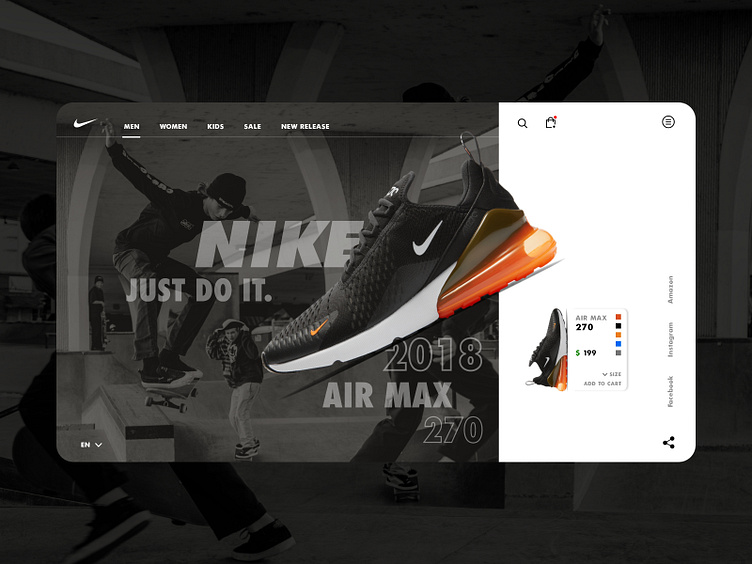

# 👟 ShoeShop — Air Max 270 Showcase Store

A dark, editorial, single-page sneaker store built around one hero product: the **Air Max 270**. It's a design concept turned into a working storefront, with a live color switcher, size picker, cart, promo codes, search and a simulated checkout.

| Role | Who | Responsibilities |
| --- | --- | --- |
| 🎨 **Designer & Product Owner** | **Fraol T.** ([@Fraol-T](https://github.com/Fraol-T)) | Visual direction, reference design, brand feel, layout, product scope, the build brief, review and sign-off at each checkpoint |
| 💻 **Developer** | **Claude** (AI coding agent by Anthropic) | Turning the design into a spec, design tokens, component architecture, state management, animation, responsiveness, build and deploy setup |

> **Disclaimer:** This is a non-commercial portfolio and learning project. "Nike", "Air Max", "Air Jordan", "Dunk", "VaporMax", "Just Do It" and the Swoosh are trademarks of Nike, Inc. This project has no affiliation with or endorsement from Nike. Prices, ratings, review counts and order details on the site are placeholders.

---

## Table of contents

1. [The design brief](#1-the-design-brief)
2. [How we worked together](#2-how-we-worked-together)
3. [Step 0: Classifying the project](#3-step-0-classifying-the-project)
4. [Step 1: Turning the image into a spec](#4-step-1-turning-the-image-into-a-spec)
5. [Step 2: The design system](#5-step-2-the-design-system)
6. [Step 3: Page anatomy](#6-step-3-page-anatomy)
7. [Step 4: Component by component](#7-step-4-component-by-component)
8. [State architecture](#8-state-architecture)
9. [Motion and interaction design](#9-motion-and-interaction-design)
10. [Responsive strategy](#10-responsive-strategy)
11. [Tech stack](#11-tech-stack)
12. [Project structure](#12-project-structure)
13. [Running it locally](#13-running-it-locally)
14. [Deployment](#14-deployment)
15. [Known limitations and roadmap](#15-known-limitations-and-roadmap)

---

## 1. The design brief

Everything started from one reference image chosen by the designer, a desktop shot of a sneaker landing page:

<p align="center">
  
</p>

What the designer wanted to keep from the reference:

- **A split card.** A dark, photographic left panel holds the brand story, and a narrow white right panel holds the "buy" controls.
- **Layered typography.** A huge, faded brand word sits *behind* the shoe, a bold tagline overlaps it, and outlined model text (`2018 / AIR MAX / 270`) sits *in front of* the shoe in the bottom-right.
- **The shoe as the hero.** One product, tilted at an angle, breaking out of its panel and casting a strong shadow.
- **A small, dense product widget.** Thumbnail, model name, color swatches, price, size and "Add to cart", all inside one compact card.
- **Quiet chrome.** A minimal nav (`MEN · WOMEN · KIDS · SALE · NEW RELEASE`), search and bag icons, a round menu button, social links, a share icon and a language selector (`EN ∨`).
- **Palette.** Near-black, white, and one loud accent: the orange of the Air unit.

The designer also wrote the build brief ([`AGENTS-new-project.md`](./AGENTS-new-project.md)). It set the "high-end" quality bar the developer had to meet: responsive, accessible, fast, animated with care, and no fake business data presented as real.

---

## 2. How we worked together

The brief called for **review-driven development** with three checkpoints, because a wrong assumption made early carries into everything built on top of it.

```
 Designer (Fraol)                         Developer (Claude)
 ────────────────                         ──────────────────
 Reference image + brief  ───────────▶   Classify the project (Step 0)
                                          Reverse-engineer a written spec (Step 1)
                                          List open questions
 Answer questions, approve spec ◀──────  ✅ Checkpoint 1: Spec
                                          Build design tokens (colors, type, radii)
 Approve look & feel  ◀────────────────  ✅ Checkpoint 2: Design system
                                          Build components bottom-up,
                                          then assemble the full page
 Review against reference ◀────────────  ✅ Checkpoint 3: First full page
 Final tweaks, ship  ──────────────────▶  Build fixes, Vercel deploy
```

**The designer owned** what it should look and feel like, which product to feature, which pages and sections existed, and the copy tone.
**The developer owned** how to build it: component boundaries, data shapes, state, animation implementation, breakpoints the image didn't show, and the empty, success and error states a static screenshot never includes.

---

## 3. Step 0: Classifying the project

Before analyzing the image, the developer classified the project as a **web store**, not a marketing site. That choice decided which requirements applied:

- Products need a defined data structure **before** any catalog UI is built.
- The cart icon has to work: add, remove, change quantity, and survive a page refresh.
- Search, filters and "Add to cart" need real behavior, not just a static look.
- Raw card data must never be handled client-side, so the checkout is clearly **simulated** until a real processor (Stripe) is wired in.

---

## 4. Step 1: Turning the image into a spec

The developer broke the reference down into a written spec before writing any code.

### Layout

| Region in the reference | What it became |
| --- | --- |
| Dark left panel (~⅔ width) | `HeroShowcase`, 8 of 12 grid columns on desktop |
| White right panel (~⅓ width) | `ProductQuickWidget`, 4 of 12 columns |
| Top nav row, split dark/white | `HeaderNav`, using the same 8/4 split so the seam lines up with the card below |
| Faded "NIKE" + "JUST DO IT." | Background typography layer (z-10) |
| Tilted shoe | Interactive 3D-tilt shoe layer (z-20) |
| Outlined "2018 / AIR MAX / 270" | Foreground stroke-text layer |
| `EN ∨` bottom-left | Working language dropdown |
| Vertical social links + share icon | Social link row + copy-link share button |

### Interactions the image implied but didn't show working

The screenshot is one desktop frame, so the developer listed every control that looked clickable and gave each one real behavior:

- 🔍 **Search icon** → full-screen search modal with live filtering
- 👜 **Bag icon** → slide-over cart drawer with a live count badge
- 🎨 **Color swatches** → switch the hero shoe image *and* the widget thumbnail
- 📏 **Size ∨** → size grid dropdown (US 7 to US 12)
- 🛒 **Add to cart** → adds the chosen color and size, plays a confetti burst, opens the cart
- 🗂 **Nav categories** → filter the product catalog
- 🌐 **EN ∨** → language picker (EN / FR / DE / ES / JP; visual only for now)
- 🔗 **Share** → copies the page URL to the clipboard and confirms with "Link Copied!"

### What the image couldn't say: sections added below the fold

The reference is only a hero. To make a full store page, the designer approved these extra sections, built in the same visual language:

1. Announcement bar (free shipping + promo code)
2. Trust bar (delivery · returns · authenticity)
3. Product catalog with category tabs
4. Air Max 270 tech-spec feature banner
5. Newsletter / VIP club signup
6. Four-column footer

---

## 5. Step 2: The design system

Tokens live in one place, [`src/app/globals.css`](./src/app/globals.css), using Tailwind CSS v4's `@theme` block. Components reference these tokens rather than one-off values.

### Color palette (sampled from the reference)

| Token | Hex | Used for |
| --- | --- | --- |
| `--background` | `#0d0d0f` | Page background |
| `--color-nike-dark` | `#111113` | Hero panel, drawers, footer |
| `--color-nike-card-dark` | `#18181c` | Cards, modals, trust tiles |
| `--color-nike-orange` | `#ff5500` | **The single accent**: CTAs, active states, badges, glow, text selection |
| `--color-nike-gray` | `#8e8e93` | Secondary text |
| `--color-nike-gray-light` | `#f5f5f7` | Light-panel surfaces |
| `--color-nike-light` | `#ffffff` | Right panel, primary text on dark |

The design rule: **one accent color only.** Orange is the color of the Air unit in the reference photo, so it marks every "this is interactive / this is important" moment. Success states use emerald so they never compete with the brand accent.

### Typography

| Role | Typeface | Loaded via | Why |
| --- | --- | --- | --- |
| Display (`font-display`) | **Bebas Neue** | `next/font/google` | Tall, condensed, all-caps. Matches the poster-style "NIKE" and "AIR MAX 270" lettering in the reference |
| Body / UI (`font-sans`) | **Plus Jakarta Sans** | `next/font/google` | Geometric and very legible at the tiny 10–12px uppercase sizes the nav and labels use |

Type is used at extremes: the background "NIKE" runs up to **320px**, while labels sit at **10–11px** with wide letter-spacing (`tracking-widest`). The large gap between the two is what gives the page its editorial feel.

### Custom utilities

| Class | Effect | Where |
| --- | --- | --- |
| `.text-stroke-white` / `.text-stroke-thick` | Transparent fill with a semi-opaque outline | The outlined "2018 / AIR MAX / 270" stack |
| `.text-stroke-dark` | Dark outline variant | Reserved for light surfaces |
| `.glass-panel-dark` / `.glass-panel-light` | 16px backdrop blur + hairline border | Overlay surfaces |
| `.writing-mode-vertical` | Vertical text | Reserved for the rotated social links in the reference |
| Custom scrollbar | Dark track, thumb turns orange on hover | Global |

### Shape language

- **Radii:** `rounded-3xl` for the outer shells (hero card, banners, drawers), `rounded-2xl` for inner cards, `rounded-xl` for buttons and inputs, `rounded-full` for badges and icon buttons.
- **Borders:** hairline `border-white/10` on dark surfaces and `border-neutral-200` on light ones, instead of heavy dividers.
- **Shadows:** deep `shadow-2xl` on the main card, and a colored **orange drop-shadow glow** (`rgba(255,85,0,0.35)`) under the shoe so it looks lit by its own Air unit.
- **Icons:** [Lucide](https://lucide.dev), stroked and monochrome, sized 14–24px.

---

## 6. Step 3: Page anatomy

```
┌──────────────────────────────────────────────────────────────┐
│ 🔥 Announcement bar — free shipping over $150 · code NIKE20  │
├──────────────────────────────────────────────┬───────────────┤
│ HeaderNav (dark, 8 cols)                     │ (white, 4 col)│
│ ✓ MEN  WOMEN  KIDS  SALE  NEW RELEASE        │ 🔍  👜³   ☰  │
├──────────────────────────────────────────────┼───────────────┤
│ HeroShowcase                                 │ ProductQuick- │
│   NIKE  (faded, 320px)                       │ Widget        │
│   JUST DO IT.            👟 (3D tilt)        │ ┌───────────┐ │
│                                    2018      │ │👟 AIR MAX │ │
│                                 AIR MAX      │ │   270 ■■  │ │
│                                     270      │ │ $199  ■■  │ │
│ 🌐 EN ∨                AIR BUBBLE TECH ──    │ │ SIZE ∨    │ │
│                                              │ │[ADD TO 🛒]│ │
│                                              │ └───────────┘ │
│                                              │ FB IG AMZ  ⤴ │
├──────────────────────────────────────────────┴───────────────┤
│ 🚚 Free delivery   │ 🔄 30-day returns  │ 🛡 Authentic       │
├──────────────────────────────────────────────────────────────┤
│ ⚡ EXPLORE THE AIR COLLECTION        [MEN][WOMEN][KIDS]...   │
│ ┌──────┐ ┌──────┐ ┌──────┐                                   │
│ │ card │ │ card │ │ card │   (3 / 2 / 1 columns)             │
│ └──────┘ └──────┘ └──────┘                                   │
│ ┌──────────────────────────────────────────────────────────┐ │
│ │ 270 DEGREES OF VISIBLE AIR   [32mm][Dual][100%]     👟   │ │
│ └──────────────────────────────────────────────────────────┘ │
├──────────────────────────────────────────────────────────────┤
│ 🧡 JOIN THE CLUB — 15% OFF          [ email ] [JOIN NOW →]   │
├──────────────────────────────────────────────────────────────┤
│ Footer: brand · Products · Get Help · Social                 │
└──────────────────────────────────────────────────────────────┘
   Overlays: CartDrawer (slides from right) · SearchModal · Checkout modal
```

All of it is assembled in [`src/app/page.tsx`](./src/app/page.tsx) inside a centered `max-w-[1400px]` container, wrapped in a single `<CartProvider>`.

---

## 7. Step 4: Component by component

Built bottom-up: shared state first, then each section, then the full page.

### `HeaderNav.tsx`: the split navigation

- Uses the **same 8/4 grid split** as the hero card, so the dark/white seam in the nav lines up exactly with the seam in the card. That alignment is the main thing that makes it read like the reference.
- Left half: inline SVG swoosh logo plus category buttons. The active category gets an orange underline that **slides** between items using Motion's shared `layoutId`.
- Right half (desktop): search, bag with a pop-in count badge, and the round three-line menu button from the reference.
- Below `md`: the category list moves into an animated hamburger drawer that also holds search and `BAG (n)` buttons.

### `HeroShowcase.tsx`: the layered hero

The reference's depth comes from four stacked layers:

| Layer | z-index | Content | Treatment |
| --- | --- | --- | --- |
| 0 | `z-0` | Urban skate photo | `grayscale`, `contrast-125`, 30% opacity, plus a dark gradient overlay |
| 1 | `z-10` | "NIKE" + "JUST DO IT." | Fades in at 15% / 85% opacity, `pointer-events-none` |
| 2 | `z-15` | "2018 / AIR MAX / 270" | Outline-only stroke text, scales in |
| 3 | `z-20` | The shoe | Spring-driven **3D tilt** that follows the mouse (±10° on X and Y), orange glow shadow, re-animates on every color change |
| 4 | `z-30` | Language picker + "AIR BUBBLE TECH" tag | Interactive chrome |

How the tilt works: on `mousemove`, the cursor position is normalized to `-0.5…0.5` across the panel, multiplied by 20, and fed into `rotateY` / `rotateX` with a spring (`stiffness: 150, damping: 15`). On `mouseleave` it springs back to flat.

The shoe image is keyed by `selectedColor`, so picking a swatch in the right panel **remounts the image** with a spring scale-and-rotate entrance. The two panels feel connected because they share state through context.

### `ProductQuickWidget.tsx`: the buy box

This is the reference's small product card, made functional:

- **Thumbnail** tilted at -12° that straightens on hover.
- **Color swatches**: Orange Air, Triple Black, Hyper Blue, Stealth Grey. These write to the shared `selectedColor`, which updates the hero too.
- **Price**: `$199 USD`, with the dollar sign in accent orange.
- **Size dropdown**: an animated 3-column grid of US sizes.
- **Add to cart**: pushes `{id, color, size, price, image}` to the cart, turns emerald with "ADDED TO BAG!" for 2s, fires a `canvas-confetti` burst in brand colors, and opens the cart drawer.
- **Footer**: social links and a share button that copies the URL via the Clipboard API.

### `ProductCatalog.tsx`: the collection

- Six products with a typed `Product` interface (id, name, subtitle, category, price, rating, reviews, image, color, `isNew`).
- Category tabs share `activeCategory` with the header nav, so clicking "SALE" in either place filters the same grid. **MEN** is the default and shows the full collection.
- Cards fade and rise in on scroll (`whileInView`, `once: true`), lift 6px on hover, and the shoe rotates from -12° to 0° and scales up.
- Per-card "ADD TO BAG" with its own 2-second "ADDED!" confirmation state.
- Ends with the **"270 Degrees of Visible Air"** tech banner and three spec tiles.

### `CartDrawer.tsx`: cart and checkout

- Slide-over panel (`x: 100% → 0`) with a blurred backdrop.
- Line items grouped by **id + color + size**, so the same shoe in two sizes appears as two lines. Includes quantity steppers and remove buttons.
- **Promo codes**: `NIKE20` gives 20% off, `FREESHIP` waives shipping, and anything else shows an inline error.
- **Totals**: shipping is free over $150 (otherwise $15), with the discount applied before shipping.
- **Checkout modal**: express-pay buttons, a name/email/address form, then a success screen with a confetti burst, order reference and delivery estimate. The cart clears automatically after 4 seconds.
- Empty-cart state with a call to action, a state the reference never shows.

### `SearchModal.tsx`: live search

- Opens from the header (desktop) or the mobile menu.
- Filters as you type across **name, colorway and category**.
- Each result can be added to the bag directly. Includes a "no results" empty state.

### `CartContext.tsx`: the shared state

See the next section.

---

## 8. State architecture

There's no backend, so one React Context ([`src/context/CartContext.tsx`](./src/context/CartContext.tsx)) acts as the store's "database":

```ts
interface CartContextType {
  // Data
  cart: CartItem[];
  cartCount: number;      // derived: total quantity
  cartTotal: number;      // derived: Σ price × qty

  // Shared UI selections (link the hero, widget, nav and catalog together)
  activeCategory: string;
  selectedColor: string;
  selectedSize: string;

  // Overlay visibility
  isCartOpen: boolean;
  isSearchOpen: boolean;

  // Actions
  addToCart, removeFromCart, updateQuantity, clearCart, /* + setters */
}
```

Design decisions:

- **Colocated UI state.** Color, size and category live in the same context as the cart, because the hero, widget, nav and catalog all read them. One provider means no prop drilling between sibling panels.
- **Composite line-item key.** `id + colorName + size` is the item's identity, so variants stay separate.
- **Persistence.** The cart is saved to `localStorage` under `nike_cart` and restored on load, with every access wrapped in `try/catch` so private browsing or blocked storage won't crash the page.
- **Derived values** (`cartCount`, `cartTotal`) are computed on render, never stored, so they can't fall out of sync.
- **Add-to-cart opens the drawer** so every add gets immediate feedback.

---

## 9. Motion and interaction design

All motion uses **Motion** (`motion/react`, formerly Framer Motion). GSAP and `@gsap/react` are installed for future scroll-driven work.

| Moment | Animation | Timing |
| --- | --- | --- |
| Hero text entrance | Fade + slide (y: 30 / x: -40) | 0.8s, staggered 0 / 0.2 / 0.3s |
| Shoe color change | Scale 0.85→1, rotate -8°→-4° | Spring (200 / 20) |
| Shoe mouse tilt | rotateX / rotateY ±10° | Spring (150 / 15) |
| Nav active underline | Shared-layout slide | Spring (380 / 30) |
| Catalog cards | Fade-up on scroll, lift on hover | Once per card |
| Buttons | Hover scale 1.02–1.1, tap 0.9–0.98 | Micro-interaction |
| Dropdowns | Fade + 5–10px slide | `AnimatePresence` exit animations |
| Cart drawer | Slide from right | `x: 100% → 0` |
| Add to cart / order placed | Confetti in brand colors | 50 / 120 particles |

Principle: animate **`transform` and `opacity` only**, so motion stays on the GPU and never triggers layout reflow.

---

## 10. Responsive strategy

The reference shows a single desktop frame (~1280px). The developer designed the other breakpoints:

| Width | Behavior |
| --- | --- |
| **≥ 1024px (`lg`)** | Full 8/4 split card and split nav, as in the reference |
| **768–1023px (`md`)** | Card stacks: hero on top, buy box below. Inline nav links remain; the white nav half hides |
| **< 768px** | Hamburger menu holds categories, search and bag. Hero type scales down from 320px to 140px. Catalog becomes one column |

Fluid type uses Tailwind's breakpoint ramps (for example `text-[140px] sm:text-[200px] md:text-[260px] lg:text-[320px]`), and the hero keeps a minimum height so the layered composition holds together on phones.

---

## 11. Tech stack

| Layer | Choice |
| --- | --- |
| Framework | [Next.js 16](https://nextjs.org) (App Router) + React 19 |
| Language | TypeScript 5 (strict) |
| Styling | Tailwind CSS v4 (`@theme` tokens, PostCSS plugin) |
| Animation | Motion 12 (`motion/react`); GSAP 3 + `@gsap/react` available |
| Icons | lucide-react |
| Effects | canvas-confetti |
| Utilities | clsx, tailwind-merge |
| Fonts | `next/font/google`: Bebas Neue, Plus Jakarta Sans (self-hosted, no layout shift) |
| Images | `next/image` (automatic sizing, lazy loading, `priority` on the hero) |
| Linting | ESLint 9 + `eslint-config-next` (Core Web Vitals + TypeScript) |
| Hosting | Vercel |

---

## 12. Project structure

```
ShoeShop/
├── AGENTS-new-project.md      # The designer's build brief & quality bar
├── reference_image.jpg        # The original design reference
├── public/
│   └── images/                # Shoe renders + urban skate background
│       ├── nike_air_max_270_{orange,black,blue}.png
│       ├── nike_air_jordan_1.png
│       ├── nike_dunk_low.png
│       ├── nike_vapormax.png
│       └── urban_skate_bg.png
└── src/
    ├── app/
    │   ├── layout.tsx         # Fonts, metadata/SEO, root <html>
    │   ├── page.tsx           # Page assembly + trust bar, newsletter, footer
    │   └── globals.css        # Design tokens & custom utilities
    ├── context/
    │   └── CartContext.tsx    # Cart + shared UI state, localStorage persistence
    └── components/
        ├── HeaderNav.tsx          # Split dark/white nav, mobile menu
        ├── HeroShowcase.tsx       # Layered typography + 3D-tilt shoe
        ├── ProductQuickWidget.tsx # Color / size / price / add-to-cart box
        ├── ProductCatalog.tsx     # Filterable grid + tech banner
        ├── CartDrawer.tsx         # Cart, promo codes, checkout modal
        └── SearchModal.tsx        # Live product search
```

---

## 13. Running it locally

Requirements: **Node.js 20+** and npm.

```bash
git clone https://github.com/Fraol-T/ShoeShop.git
```

```bash
cd ShoeShop
```

```bash
npm install
```

```bash
npm run dev
```

Then open <http://localhost:3000>.

| Script | What it does |
| --- | --- |
| `npm run dev` | Start the dev server with hot reload |
| `npm run build` | Create an optimized production build |
| `npm run start` | Serve the production build |
| `npm run lint` | Run ESLint |

**Try it out:** pick the blue swatch and watch the hero shoe change, choose a size, add to cart, then apply `NIKE20` in the cart drawer.

---

## 14. Deployment

The project deploys to **Vercel** with no extra configuration: import the repo and Vercel detects Next.js automatically. `package-lock.json` is committed and was regenerated once to fix a Vercel `npm install` error, so builds use exactly the tested dependency tree.

---

## 15. Known limitations and roadmap

The brief asked for honesty about anything stubbed, so here's what is simulated today and what would come next:

| Area | Today | Next step |
| --- | --- | --- |
| Checkout | Simulated form + success screen; **no payment is taken** | Integrate Stripe Checkout (never handle card data client-side) |
| Product data | Hard-coded arrays in components | Move to a single `products.ts` source or a CMS/database |
| Language picker | Visual only | i18n with `next-intl` |
| Newsletter | `alert()` confirmation | Real email-provider integration + inline success state |
| Footer & social links | `#` placeholders | Real routes / profiles |
| Category filter | MEN shows everything | Give each product proper gender/category tags |
| Accessibility | Semantic structure, alt text, labelled controls | Full keyboard focus trapping in modals, `prefers-reduced-motion` support, AA contrast audit |
| Animation | Motion only | GSAP ScrollTrigger parallax on the hero layers |
| SEO | Title, description, keywords | Open Graph image, sitemap, product structured data |
| Pages | Single page | Product detail pages, account, order history |

---

<p align="center">
  <b>Designed by Fraol T. · Developed by Claude</b><br>
  <sub>Built as a portfolio piece to show a designer–developer workflow from reference image to working storefront.</sub>
</p>
